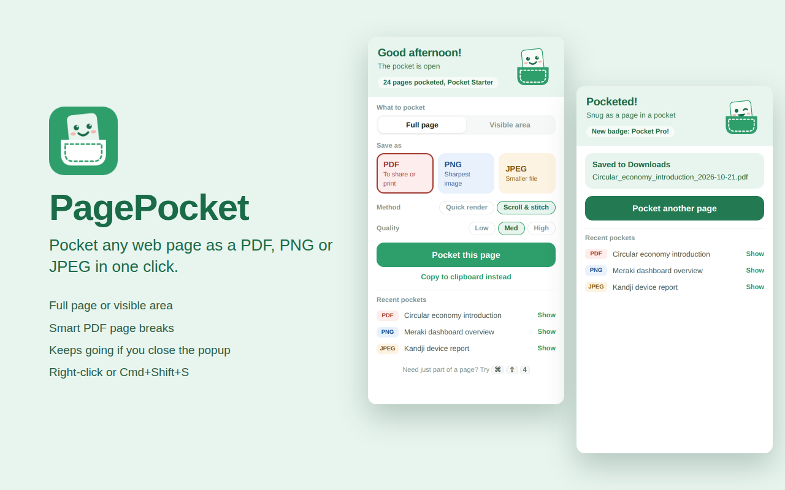

# PagePocket

A cheerful Chrome extension that saves any web page as a **PDF, PNG or JPEG** in one click, or copies it to your clipboard. Meet **Pocket pal**, who keeps you company while it works.



## Features

- **Full page** or **visible area** capture
- **PDF, PNG or JPEG**, with Low, Med or High quality
- **Copy to clipboard** for quick pasting into chat or docs
- **Two methods**
  - **Scroll & stitch**: scrolls and screenshots the real page. Most accurate.
  - **Quick render**: redraws the page with html2canvas. Faster, but some sites look odd.
- **Keeps going if you close the popup**: capture runs in the background
- **Tab lock**: pauses if you switch tabs and resumes when you come back
- **Sticky headers and cookie banners** appear once, not in every section
- **Lazy images** are loaded before capture
- **Very long pages** are split into parts instead of failing
- **Smart PDF page breaks** that avoid cutting through text where possible
- **Right-click menu** and **keyboard shortcut** (Cmd+Shift+S on Mac, Ctrl+Shift+S elsewhere)
- **Recent pockets** with "Show in folder", a **pocket counter** and milestone badges
- **Dark mode** and **reduce motion** support

## Install (unpacked)

1. Download or clone this repository
2. Go to `chrome://extensions`
3. Turn on **Developer mode**
4. Click **Load unpacked** and select this folder

The keyboard shortcut can be changed at `chrome://extensions/shortcuts`.

## Permissions

| Permission | Why |
|---|---|
| `activeTab` | Access to the current tab only when you use PagePocket |
| `scripting` | Scrolls the page, hides repeating sticky bars, runs Quick render |
| `downloads` | Saves files and opens them with "Show" |
| `storage` | Settings, counter and recent pockets, stored locally |
| `contextMenus` | "Pocket this page" in the right-click menu |
| `offscreen` | Hidden page that stitches screenshots and builds files |

No host permissions are requested, and nothing is sent anywhere.

## File structure

```
pagepocket/
  manifest.json       Extension config and permissions
  background.js       Runs captures, so they survive the popup closing
  offscreen.html/js   Stitches screenshots and builds PDF, PNG or JPEG files
  popup.html/js       The popup and Pocket pal
  shared.js           Defaults and milestones used by popup and background
  lib/
    html2canvas.min.js  DOM-to-canvas library (MIT)
    jspdf.umd.min.js    PDF library (MIT)
  icons/              16, 32, 48 and 128px icons
```

## Licence

MIT (extension code only; bundled libraries keep their own MIT licences)
